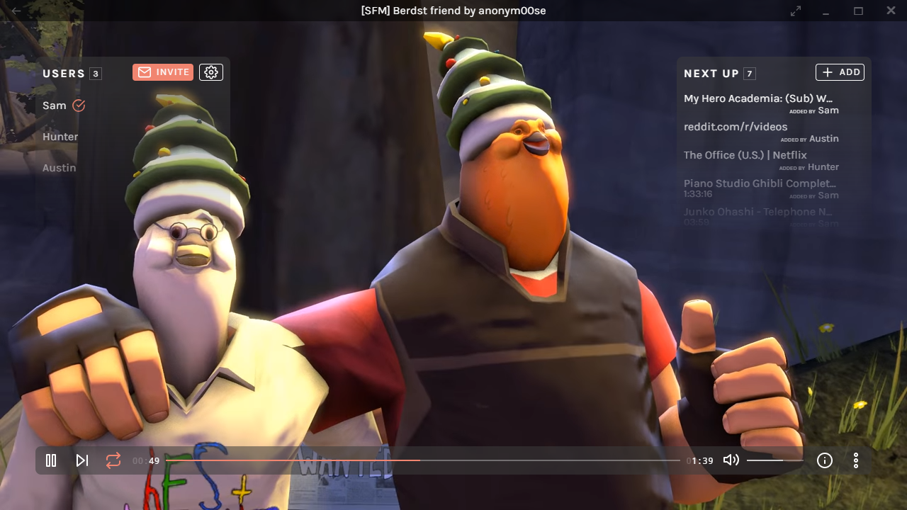
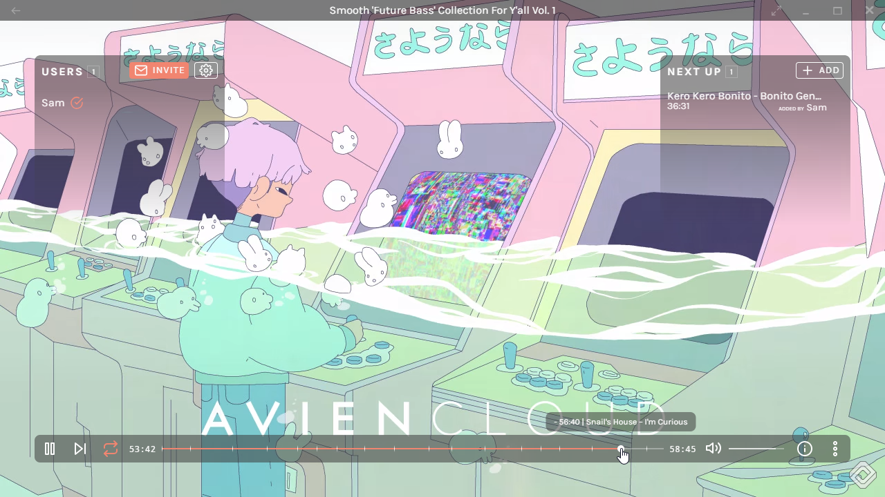
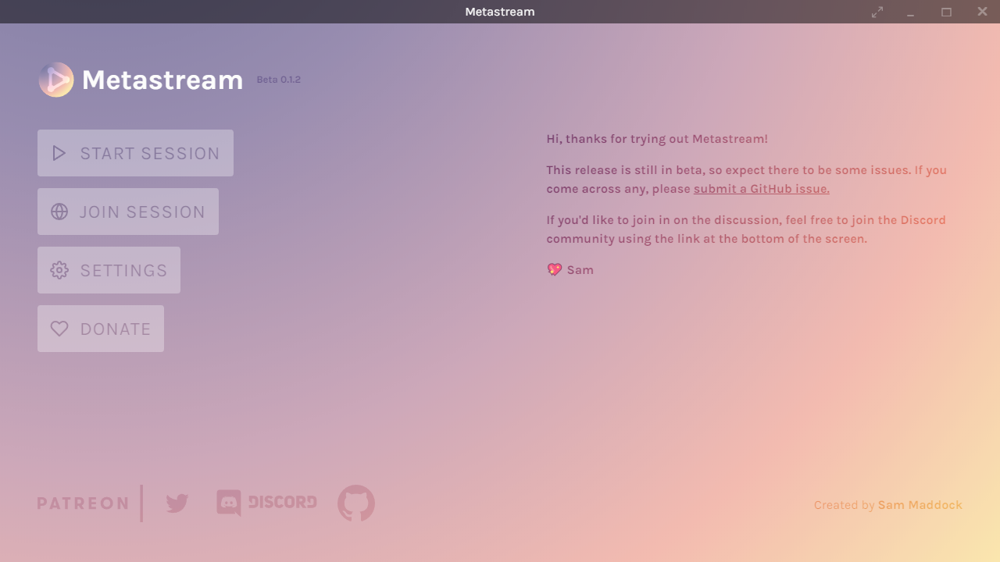

<h1 align="center">
  <br>
  <a href="https://getmetastream.com">
    
  </a>
  <br>
  Metastream
  <br>
  <br>
</h1>

<h4 align="center">Watch streaming media with friends.</h4>

<p align="center">
  <a href="https://discord.gg/nfwPRb9"></a>
</p>

## Features

- Supports Chromium and Firefox browsers.
- Synchronized playback of streaming media across various websites.
- Public, private, and offline sessions.
- Support for WebRTC peer-to-peer connections.
- Real-time chat.
- Collaborative media queue.
- [Timestamp cue points](./resources/screenshots/screenshot2.png) parsed from media description.
- Auto-fullscreen of embedded media.
- Per-user playback permissions, managed by the host.
- Basic host administrative functionality (kicking peers).

#### Are you a website owner?
Easily add watch party support to your website by redirecting the user to Metastream.
```html
<a href="https://app.getmetastream.com/?url=https://youtu.be/3bNITQR4Uso">Watch in Metastream</a>
```

## Screenshots







## Archive

As of August 2024, Metastream has discontinued publishing under open source and is no longer
accepting contributions. The latest open source version of Metastream (v0.10.4) is available in the
`archive` branch.
